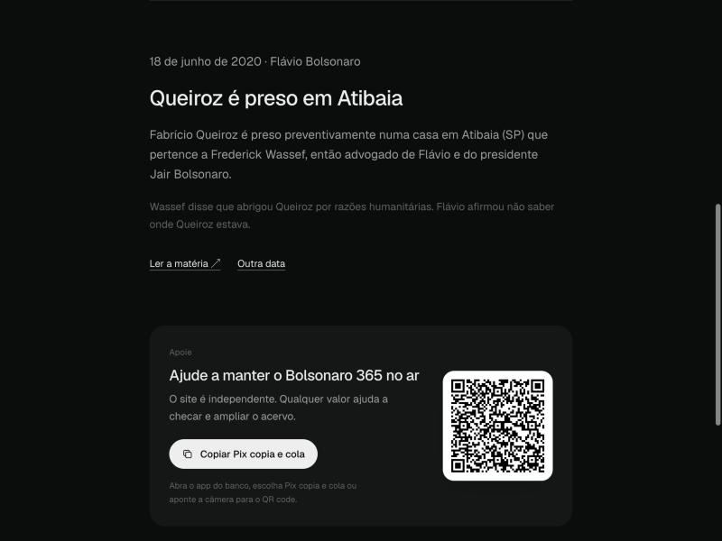
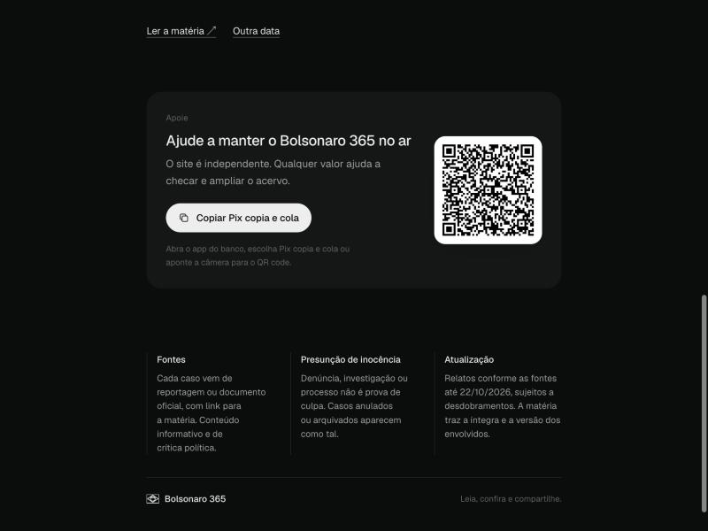

<h1 align="center">Bolsonaro 365</h1>

  <a href="https://th38amorim.github.io/bolsonaro-365/"><strong>Abrir o site →</strong></a>

  

  

## O acervo

| | |
|---|---|
| **364** | dias do ano com caso, de 366 possíveis |
| **2007 a 2026** | período coberto |
| **1 por dia** | sempre com link para reportagem ou documento oficial |

Entram denúncias, investigações, decisões judiciais, atos de governo polêmicos e declarações checadas por agências como Aos Fatos e Lupa. Envolve Jair, Flávio, Carlos, Eduardo, Jair Renan, Michelle e pessoas próximas, sempre com a ligação dita no texto.

  

## Aviso

Conteúdo informativo e de crítica política, a partir de reportagens e documentos oficiais. Denúncia, investigação ou processo não é prova de culpa: vale a presunção de inocência. Casos anulados ou arquivados aparecem como tal. Os relatos refletem as fontes até a data de atualização e podem ter desdobramentos.

Encontrou um erro de data ou de fonte? [Abra uma issue](https://github.com/th38amorim/bolsonaro-365/issues/new).
